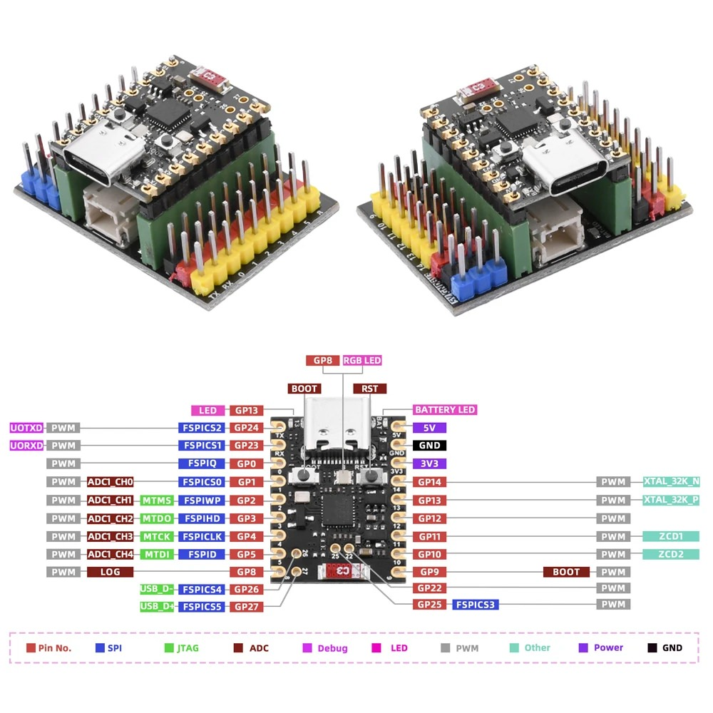
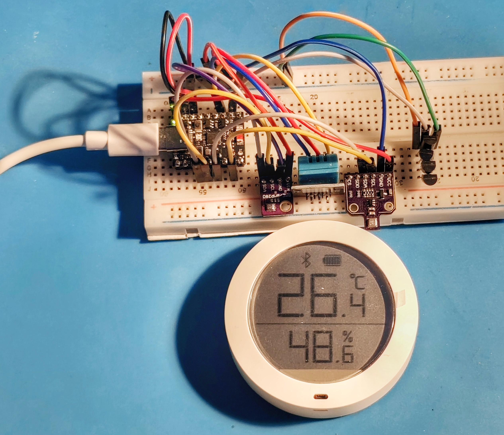
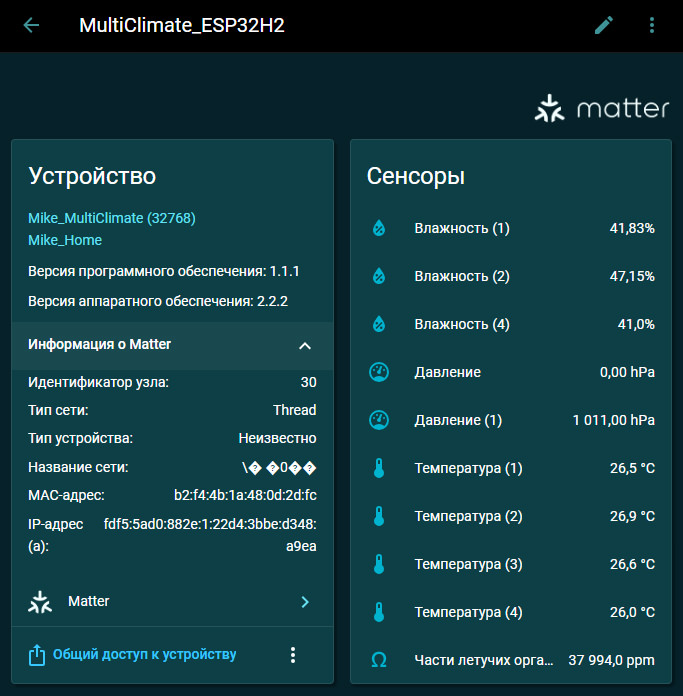
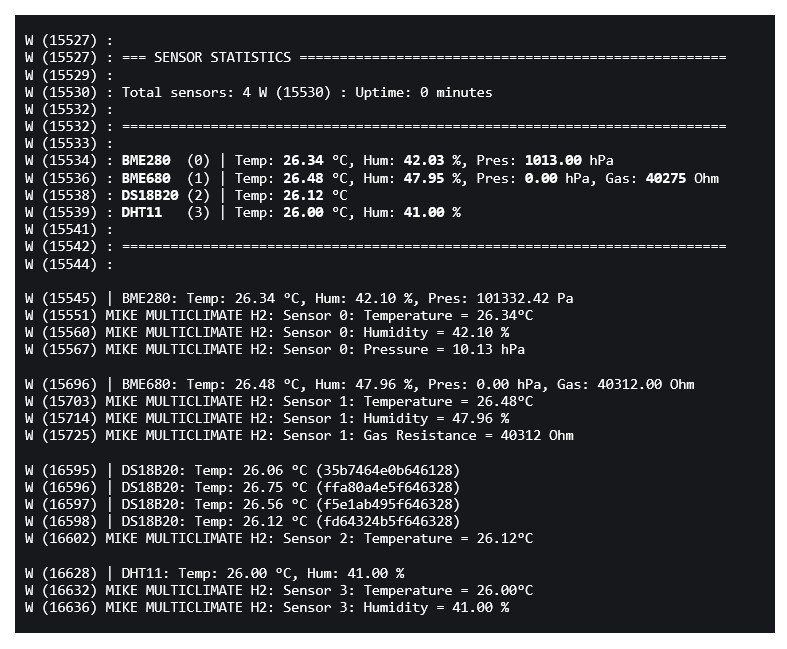
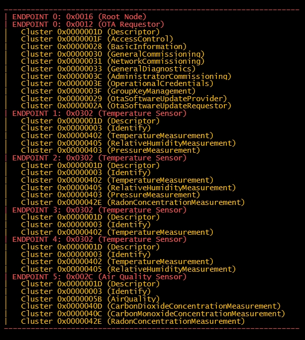

# Climate Sensors on ESP-32-H2

- BME280
- BME680
- DS18B20
- DHT11
- MQ135
- SHT41
  
Button actions:  
- Single-click: toggle SSD1306
- Double-click: toggle LED Indicator
- Hold for 3 sec to reboot
- Hold for 10 sec to factory reset

### ESP32-H2 SuperMini
  

### Layout
  

### Home Assistant
  

### ESP-IDF Log
  
  
