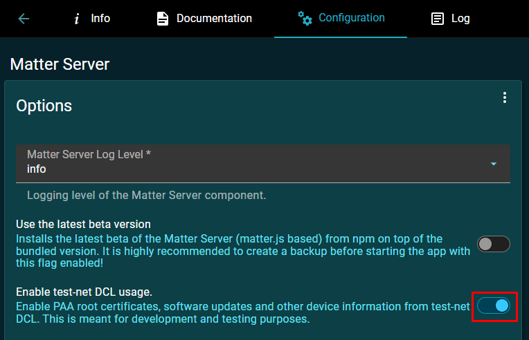
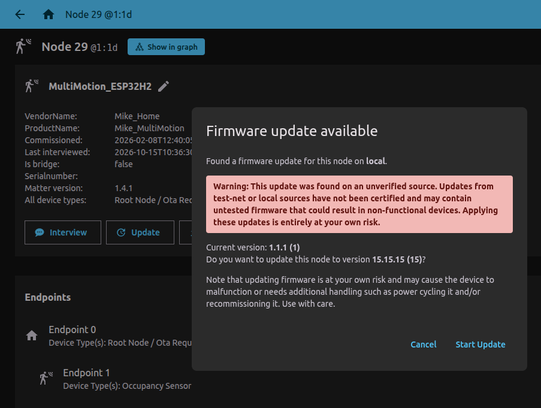

# Matter Server: Firmware Update

### 1) Configure Matter Server app
To accept test VID/PID values there should be "Enable test-net DCL usage" option switched ON.  
  
  
### 2) Change version in the CMakeLists.txt file:
> #-- BasicInformationCluster (ClusterId 40, 0x0028), Endpoint 0  
> #-- AttributeId 9: SoftwareVersion  
> set(PROJECT_VER_NUMBER **1**)  
> #-- AttributeId 10: SoftwareVersionString  
> set(PROJECT_VER "1.1.1")  
>  
  
The value of PROJECT_VER_NUMBER must be greater than existing (for example, was **1**, the new one **2**). 
> set(PROJECT_VER_NUMBER **2**)  
>  
  
Any other parameters are not used for the update process and do not matter for it.  

### 3) Set the version for creating the OTA-file
When the project building starts, in the *build* folder will be created the file *build/args-ota-image.tmp*:  
>  
> --vendor-id  
> 0xfff1  
> --product-id  
> 0x8000  
> --version  
> **2**  
> --version-str  
> **1.1.1**  
> --digest-algorithm  
> sha256  
>  

The same values must be set in the _ota.sh script to make OTA firmware file:
> python3 "\${OTA_SCRIPT_PATH}/ota_image_tool.py" create \  
>     -v 0xFFF1 \  
>     -p 0x8000 \  
>     -vn **2** \  
>     -vs "**1.1.1**" \  
>     -da sha256 \  
>     "\$BIN_FILE" \  
>     "\$OTA_FILE"  
>  

As a result of execution of this script will be the OTA file **PROJECTNAME.ota** generated.  
  
Moreover, if the parameter **CONFIG_CHIP_OTA_IMAGE_BUILD=y** set in *sdkconfig.default*, there will be the OTA file **PROJECTNAME-ota.bin** generated in the *build* folder automatically.

### 4) Upload firmware
This file should be used for "Upload Firmware" for the node with VID (0xFFF1) and PID (0x8000).  
  
***If there are more than one node with the same VID/PID, the first one will be updated!***  

  
  
  
  
  
  
