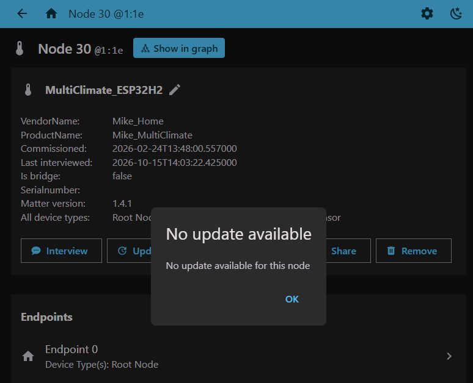
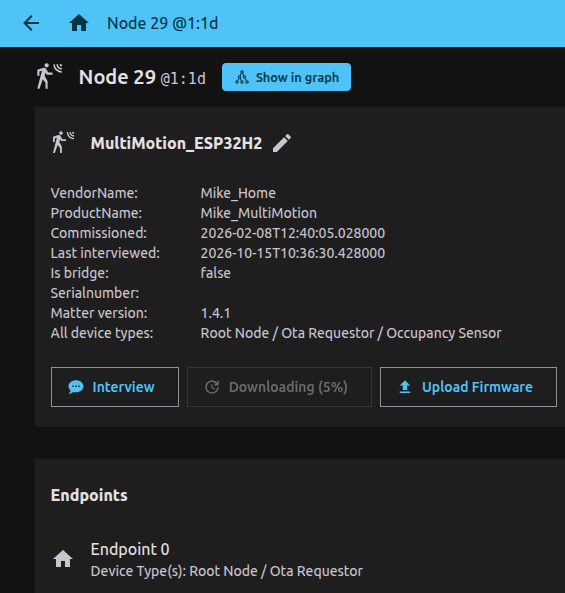

# Matter Server: Firmware Update

### 1) Configure the Matter Server app
To allow the system to accept test VID/PID values, you must enable the "Enable test-net DCL usage" option.  
  
  
### 2) Change the version in the CMakeLists.txt file:
> #-- BasicInformationCluster (ClusterId 40, 0x0028), Endpoint 0  
> #-- AttributeId 9: SoftwareVersion  
> set(PROJECT_VER_NUMBER **1**)  
> #-- AttributeId 10: SoftwareVersionString  
> set(PROJECT_VER "1.1.1")  
>  
  
The "PROJECT_VER_NUMBER" value must be higher than the current one (for example, if it was **1**, the new value should be **2**). 
> set(PROJECT_VER_NUMBER **2**)  
>  
Otherwise, the update will not take effect.  
  
  
Other parameters are not used during the update process and have no impact on it.  

### 3) Set the version for creating the OTA-file
When building the project, a file named *build/args-ota-image.tmp* is generated in the *build* directory:  
>  
> --vendor-id  
> 0xfff1  
> --product-id  
> 0x8000  
> --version  
> **2**  
> --version-str  
> **1.1.1**  
> --digest-algorithm  
> sha256  
>  

These same values ​​must be specified in the *ota.sh* script to create the firmware OTA file:
> python3 "\${OTA_SCRIPT_PATH}/ota_image_tool.py" create \  
>     -v 0xFFF1 \  
>     -p 0x8000 \  
>     -vn **2** \  
>     -vs "**1.1.1**" \  
>     -da sha256 \  
>     "\$BIN_FILE" \  
>     "\$OTA_FILE"  
>  

Executing this script will generate an OTA file named **PROJECTNAME.ota**.  
  
Additionally, if the parameter **CONFIG_CHIP_OTA_IMAGE_BUILD=y** is set in the *sdkconfig.default* file, an OTA file named **PROJECTNAME-ota.bin** will be automatically created in the *build* directory.  

### 4) Upload firmware
This file should be used for the "Upload Firmware" operation on a node with the corresponding VID (0xFFF1) and PID (0x8000) identifiers.  
  
***If there are multiple nodes with the same VID/PID, the update will be applied to the first one!***  

  
  
  
  
  
  
  
  
